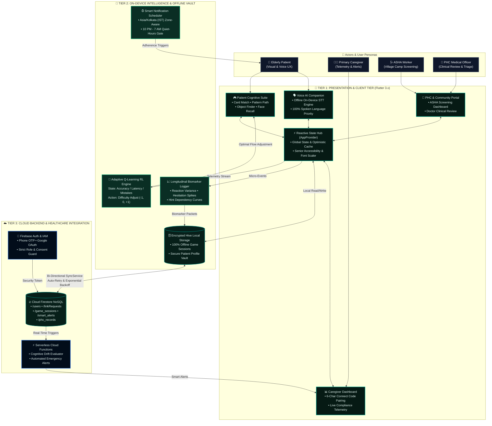
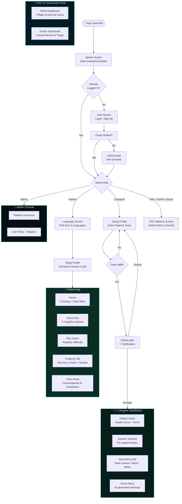
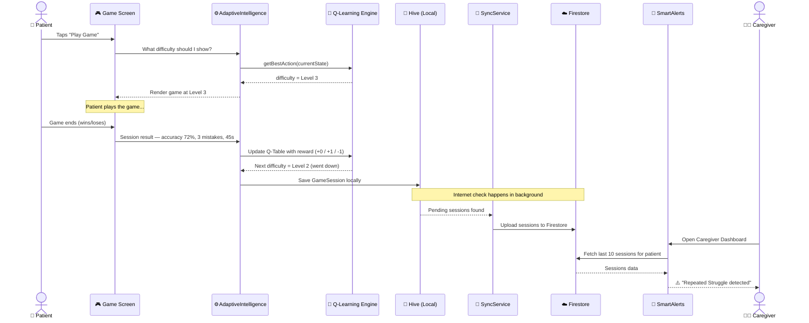
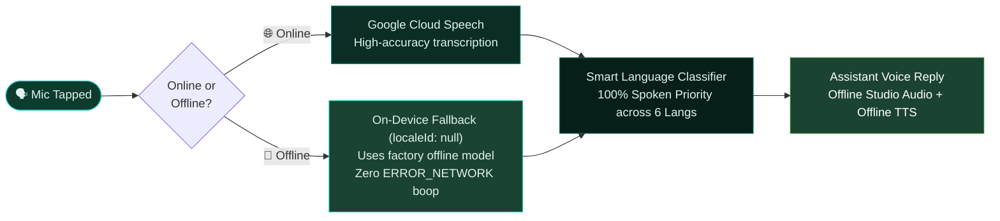

<div align="center">


# NeuroVerse

### Adaptive Cognitive Health & Neuro-Rehabilitation Platform
**Smart India Hackathon 2026 — Prototype**

*Flutter · Firebase · On-Device Q-Learning · Offline-First · 9 Indian Languages*

[](LICENSE)

---

</div>

## Overview

**NeuroVerse** is a mobile-first, offline-capable cognitive health and neuro-rehabilitation platform designed to help elderly patients monitor, preserve, and strengthen their cognitive abilities through engaging, culturally-grounded mini-games. 

It features an on-device adaptive Q-Learning reinforcement engine, real-time caregiver tele-monitoring, a Primary Health Centre (PHC) & ASHA community screening network, an offline-resilient multilingual voice companion, and a multi-tier role-based ecosystem for **Patients**, **Caregivers**, **PHC Workers (ASHA & Doctors)**, and **Admins**.

---

## ✨ Features

### 👴 Patient Dashboard
- **Game Hub** — Four dedicated cognitive mini-games (**Card Match**, **Pattern Path**, **Object Finder**, **Face Recall**) that scale in difficulty dynamically using an on-device Q-Learning engine (automatically lowering difficulty when patients struggle to eliminate frustration).
- **100% Offline Multilingual Localization (9 Languages)** — Complete support for English, Hindi, Bengali, Assamese, Manipuri, Mizo, Kannada, Telugu, and Marathi with 824+ translation keys per language, zero-restart reactive re-rendering, and independent App UI vs. Spoken Voice language selection.
- **Dementia-Friendly Game Onboarding** — Culturally-grounded North-East Indian visual cues and structured 3-step guides with studio-grade Indian neural voice narration.
- **In-Game Assistance (Hint Engine)** — Dementia-friendly hints across all games (distractor dimming, next-tile pathway glow, card peek, and photo cues) with hint usage analytics.
- **Emergency SOS & Caregiver Alerting** — One-tap prominent emergency alert with haptic feedback, instantaneous SMS dispatch, live GPS coordinates, and real-time FCM cloud notifications to linked caregivers.
- **Celebration & Rewards** — Screen-wide 3D paper confetti celebration with performance breakdown (Accuracy, Difficulty Level, Hints Used, Time Duration).
- **Progress Tab & Active Days Dialog** — Live performance analytics: streaks, accuracy trends, 14-day interactive activity calendar, and daily telemetry.
- **Offline-Resilient Voice Assistant** — Hands-free continuous conversational loop with auto-listen:
  - **Zero-Crash Offline Engine**: Automatically detects network status and uses the device's native on-device speech engine (`localeId: null`) when offline, preventing Android `ERROR_NETWORK` cancel-sound loops.
  - **100% Spoken Language Priority**: Spoken voice input always dictates the response language across all 6 supported languages, irrespective of the settings dropdown.
  - **Bilingual & Phonetic Support**: Accurately recognizes Devanagari English (e.g., *"हेलो"*, *"स्टार्ट गेम"*, *"फेस रिकॉल"*) and Romanized Hinglish (e.g., *"namaste"*, *"kaise ho"*, *"shuru karo"*).
  - **Compassionate Emotional Triage**: Gentle conversational support for geriatric loneliness, anxiety, and confusion.
- **Profile & Settings** — Personalized profiles with dark/light mode, independent App Display vs. Voice Assistant language selection, sound effects toggle, and cloud sync status.
- **Reliable Daily Reminders & Quiet Hours Guard** — Programmatic suppression between 10:00 PM and 7:00 AM, exact Asia/Kolkata (IST +5:30) timezone scheduling:
  - 🌅 **9:00 AM Morning Reminder** — Encourages daily morning cognitive training.
  - 🌙 **7:00 PM Evening Catch-Up Reminder** — Nudges if no games have been played today (auto-cancels as soon as workout is played).
  - 🌐 **Offline Multilingual Localization (9 Languages)** — Notifications for medication, hydration, and brain exercises automatically adapt to the patient's selected regional language with native Indian date formatters.

---

### 🧑‍⚕️ Caregiver Dashboard
- **Dual & Multi-Caregiver Support** — Multiple family members or nurses can simultaneously link to a single patient's profile using the secure 6-character `Connect Code`.
- **Consent-Driven Handshake** — Connection requests arrive in the patient's in-app Notification Drawer, requiring patient review and approval before linking.
- **Patient Overview & Live Telemetry** — Real-time telemetry cards showing linked patients' cognitive health score, accuracy trends, active days consistency, and streak status with time-aware greetings.
- **Multi-Patient Task Dropdown Accordion** — Tap any linked patient card to smoothly expand and reveal their real-time cognitive tasks, accuracy %, difficulty level, and duration.
- **Direct Game & Health Reminders Hub** — Send instant interactive notifications to individual patients or batch-alert all patients via the `Select All` toggle:
  - 🧠 *Brain Exercises* — Reminds patient to complete daily cognitive training games.
  - 💧 *Hydration Reminder* — Gentle nudges to drink water throughout the day.
  - 💊 *Daily Medication* — Timely medication adherence reminders.
  - 🌟 *Wellness Check-In* — Thoughtful check-ins to monitor patient emotional well-being.
- **Real-Time Cloud Sync** — Sync button with live status indicator (Green dot = synced, Orange = pending) and 2.3-second auto-closing confirmation modal.
- **Smart Alerts Engine** — Automatically analyzes last 10 sessions and surfaces alerts for:
  - 🔴 *Repeated Struggle* — accuracy repeatedly below threshold (>20% plunge).
  - 🟡 *Activity Gaps* — no gameplay for 48+ hours.
  - 🟠 *Unusual Decline* — significant performance or reaction-time deviation.
- **Push Notifications** — Critical alerts trigger real-time local push notifications with senior-safe haptic patterns.

---

### 🏥 PHC & Community Healthcare Network (ASHA / Doctor Portal)
- **Primary Health Centre (PHC) Ecosystem** — Designed specifically for grassroots rural healthcare delivery in Northeast India and underserved regions.
- **ASHA Worker Dashboard**:
  - Village-level patient registration and cognitive camp screening.
  - Offline administration of cognitive assessments for rural elderly citizens.
  - Direct tracking of screening status, adherence, and referral flags.
- **Medical Officer / Doctor Dashboard**:
  - Facility-level oversight (`PHC-JHT-108` and regional health centers).
  - Clinical review of escalated cases and risk stratification.
  - Seamless escalation from community ASHA screening to primary care doctors.

---

### 🔐 Admin Console
- Platform health dashboard with aggregated statistics (active users, sessions, distributions).
- Privacy-first architecture: no individual patient health data exposed at admin level.

---

## 🧠 Adaptive Intelligence (On-Device Q-Learning)

NeuroVerse includes a custom **Reinforcement Learning engine** (`QLearningService` + `AdaptiveIntelligenceService`) that runs entirely on-device:

- Tracks accuracy, completion time, and mistake count per session
- Rewards or penalizes difficulty states using a Q-table
- Adjusts the next game's difficulty **up or down** automatically
- Ensures the patient is always in the optimal *"challenge zone"* — not too easy, not too frustrating

---

## 🎮 Cognitive Games

| Game | Cognitive Domain | North-East Theme | In-Game Hint System |
|------|-----------------|------------------|---------------------|
| **Card Match** | Short-term memory, visual recognition | Kopou Orchid & Assam Tea Estates Edition | Peek Card Reveal |
| **Pattern Path** | Sequential memory, attention span | Cherrapunji Living Root Bridges Trail | Next-Tile Pathway Illumination |
| **Object Finder** | Visual working memory, object recall | Northeast Cultural & Heritage Image Cards | Card Highlight Prompt |
| **Face Recall** | Facial recognition, biographical memory | Family & Heritage Album (Caregiver-uploaded + Demo fallback) | Distractor Dimming & Replay Clue |

All games feature:
- Cultural theme badges & streamlined 3-step instructions narrated in natural Indian voice
- Full starting screen audio narration (`intro_*`) across all 6 languages with zero duplicacy
- Dynamic voice prompt in Face Recall (*"Tap on the photo of your friend/family member"*)
- Offline phonetic Indic transliteration for family member names
- Accuracy, speed, and hint metrics logged directly to Firestore & Hive
- Dynamic 3D confetti celebration on completion
- Adaptive difficulty controlled by on-device Q-Learning

---

## 📐 Architecture

NeuroVerse is built on **Clean Architecture** — UI never talks directly to Firebase or Hive. Every interaction passes through a service layer. All dependencies are injected at startup via `MultiProvider`.

---

### 🗺️ System Overview — Who talks to what



---

### 🚶 User Journey — From Install to Playing



---

### 🎮 What happens when a Patient plays a game



---

### 📡 Offline-First & Voice Resilience Strategy



---

### 🗃️ Detailed File Structure

```
NeuroVerse/
│
├── android/
│   └── app/
│       ├── build.gradle.kts              # Release build config
│       ├── proguard-rules.pro            # R8 rules for Flutter + Firebase
│       └── src/main/
│           ├── AndroidManifest.xml       # Microphone, Bluetooth & Network permissions
│           └── res/drawable/launch_background.xml
│
├── assets/
│   ├── audio/voice/                      # Studio audio assets for 6 languages (en, hi, bn, as, mni, miz)
│   └── images/                           # Launcher icons, botanical graphics, memory card assets
│
└── lib/
    ├── main.dart                         # Non-blocking DI bootstrap + MultiProvider root
    │
    ├── app/
    │   ├── app.dart                      # NeuroVerseApp — MaterialApp + theme binding
    │   └── theme/
    │       ├── app_colors.dart           # Central color registry (Light + Dark tokens)
    │       └── app_theme.dart            # ThemeData — typography, card, input styles
    │
    ├── core/
    │   ├── localization/
    │   │   ├── app_translations.dart     # 824+ key translations across 9 Indian languages
    │   │   └── indic_transliteration.dart# Offline phonetic transliteration for names
    │   ├── models/
    │   │   ├── game_session.dart         # GameSession model (Hive @HiveType)
    │   │   └── family_member.dart        # Custom family member model for Face Recall
    │   ├── services/
    │   │   ├── q_learning_service.dart   # Q-table, state-action rewards
    │   │   ├── adaptive_intelligence_service.dart
    │   │   ├── smart_alerts_service.dart # Analyzes last-N sessions, emits alerts
    │   │   ├── firebase_link_service.dart# Connect Code generation & verification
    │   │   ├── notification_service.dart # flutter_local_notifications wrapper
    │   │   ├── reminder_service.dart     # Daily reminder scheduling
    │   │   ├── sync_service.dart         # Offline queue → Firestore batch sync
    │   │   └── voice_service.dart        # Resilient STT + TTS engine with offline fallback
    │   └── widgets/
    │       ├── about_neuroverse_dialog.dart
    │       └── active_days_dialog.dart   # 14-day interactive activity & streak calendar
    │
    ├── data/
    │   ├── local/
    │   │   └── hive_service.dart         # Hive box init, CRUD for sessions & profiles
    │   └── remote/
    │       ├── firebase_auth_service.dart# Auth wrappers
    │       └── firestore_service.dart    # Firestore read/write for sessions & alerts
    │
    ├── providers/
    │   └── app_provider.dart             # Global ChangeNotifier (theme, user state, language)
    │
    └── features/
        ├── auth/                         # Login · Signup · Email Verification
        ├── role_selection/               # Role picker (Patient / Caregiver / PHC Network)
        ├── onboarding/
        │   ├── splash_screen.dart
        │   ├── language_screen.dart      # 6-language selection screen
        │   ├── setup_profile_screen.dart # Patient profile creation + Connect Code gen
        │   └── caregiver_setup_profile_screen.dart
        ├── patient/
        │   ├── home/                     # Patient home dashboard
        │   ├── games/
        │   │   ├── game_hub/             # Game selection grid
        │   │   ├── memory_match/         # Card-flip memory game (Card Match)
        │   │   ├── pattern_path/         # Simon-Says sequence game (Pattern Path)
        │   │   ├── face_recall/          # Family album recognition game (Face Recall)
        │   │   ├── memory_recall/        # Object memorization game (Object Finder)
        │   │   └── common/               # Shared game intro screens & scorebars
        │   ├── progress/                 # Live analytics: streaks, accuracy, charts
        │   ├── profile/                  # Patient profile view & edit
        │   ├── settings/                 # Font size, dark mode, language dropdowns
        │   └── voice/                    # Voice assistant mode with 100% spoken priority
        ├── caregiver/
        │   └── overview/
        │       └── caregiver_main_screen.dart # Patient cards, alerts, session timeline
        ├── phc_network/
        │   ├── data/                     # PHC repository & cloud sync
        │   ├── models/                   # ASHA patient screening models
        │   └── presentation/
        │       ├── phc_role_selection_screen.dart
        │       ├── asha/                 # ASHA Worker dashboard & screening tools
        │       └── doctor/               # Medical Officer clinical triage dashboard
        └── admin/
            └── dashboard/                # Platform aggregated analytics
```

---

## ⚙️ Tech Stack

| Layer | Technology |
|-------|-----------|
| Framework | Flutter 3.x (Dart) |
| State Management | Provider (`MultiProvider`) |
| Local Storage | Hive + hive_flutter (Offline DB) |
| Cloud Backend | Firebase Auth + Cloud Firestore |
| Authentication | Firebase Auth (Email/Password + Google Sign-In) |
| Notifications | flutter_local_notifications (Timezone-aware scheduling) |
| Audio Playback | audioplayers (Studio-grade pre-recorded regional clips) |
| Text-to-Speech | flutter_tts (Offline hardware synthesizer) |
| Speech-to-Text | speech_to_text (Resilient cloud + on-device offline fallback) |
| Adaptive AI | Custom Q-Learning (on-device, zero-latency reinforcement) |
| Sync | Custom SyncService (Offline queue → Firestore batch uploader) |

---

## 🧪 Automated Testing Suite

NeuroVerse features automated unit and widget test suites:

- **Voice Assistant & Spoken Language Priority**:
  `flutter test test/features/patient/voice/voice_mode_screen_test.dart` (14 passing tests)
- **Voice Service & Online/Offline Connectivity**:
  `flutter test test/core/services/voice_service_test.dart` (3 passing tests)
- **Face Recall Adaptive Progression & Transliteration**:
  `flutter test test/features/patient/games/face_recall_test.dart` (11 passing tests)
- **Comprehensive Localization & Game Intros**:
  `flutter test test/features/patient/localization_games_and_voice_test.dart` (28+ passing tests)

---

## 🚀 Getting Started

### Prerequisites
- Flutter SDK ≥ 3.11.0
- Android device or emulator (API 21+)
- Firebase project with Auth + Firestore enabled

### Setup

**1. Clone and install dependencies**
```bash
git clone https://github.com/3107Alok/NeuroVerse.git
cd NeuroVerse
flutter pub get
```

**2. Firebase Configuration**
```bash
# Copy the example and fill in your Firebase keys
cp android/app/google-services.example.json android/app/google-services.json
```
- Create a Firebase project at [console.firebase.google.com](https://console.firebase.google.com)
- Enable **Email/Password** and **Google Sign-In** under Authentication
- Enable **Cloud Firestore**
- Generate SHA-1 / SHA-256 fingerprints: `gradlew signingReport`
- Add fingerprints to your Firebase Android app and download `google-services.json`

**3. Run in debug mode**
```bash
flutter run
```

**4. Build release APK**
```bash
flutter build apk --split-per-abi
# Output for ARM64: build/app/outputs/flutter-apk/app-arm64-v8a-release.apk
```

---

## 🛡️ Security

| Feature | Implementation |
|---------|---------------|
| Secret Management | `google-services.json` is gitignored; example template provided |
| Rate Limiting | `too-many-requests` Firebase exceptions caught and surfaced to UI |
| Email Verification | Enforced at signup; unverified accounts are blocked |
| Password Recovery | "Forgot Password?" email flow |
| Connect Code Resilience | 6-character unique codes with timeout protection, zero-stall fallback, and auto-repair |
| Email Verification Reload | Real-time Firebase token reload (`user.reload()`) upon manual email sign-in |
| Profile Completeness Guard | Strict role & name checks prevent incomplete profiles from bypassing onboarding |
| Offline Resilience | All game sessions stored locally in encrypted Hive first; Firestore sync only on connectivity |

---

## 📱 App Icon & Theming

- **Icon:** 3D glowing synaptic brain on a deep emerald background — seamless circular adaptive icon on all Android launchers
- **Theme:** Dark emerald (`#001B17`) primary, teal-cyan accent (`#00BFA5`), with glassmorphism cards and subtle micro-animations
- **Accessibility:** High-contrast text, adjustable font sizes, voice narration for all game instructions

---

## 🤝 Contributing

1. Fork the repository
2. Create a feature branch: `git checkout -b feature/your-feature`
3. Commit changes: `git commit -m "feat: add your feature"`
4. Push and open a Pull Request

---

## 📄 License

This project is licensed under the **MIT License** — see the [LICENSE](LICENSE) file for details.

---

<div align="center">

Built with ❤️ for **Smart India Hackathon 2026**

*Empowering caregivers. Engaging patients. Preserving cognition.*

</div>
